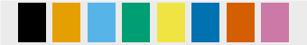

# Deskriptive Statistik und Visualisierung

[Vorlesungsaufzeichnung Deskriptive Statistik (VL 9, ab Minute 54)](https://media.hhu.de/channel/video/data-science-vl-9-stetige-verteilungen-2025/39016f5414ef3b8edd0dff941f802314/167?t=3244)
[Vorlesungsaufzeichnung Skalenniveaus und Plots (VL 10, ab Minute 49)](https://media.hhu.de/channel/video/data-science-vl-10-skalenniveaus-2025/9b824315922a75d933e081f31c1da388/167?t=2940)
[Vorlesungsaufzeichnung Simpson-Paradoxon (VL 12)](https://media.hhu.de/channel/video/data-science-vl-12-simpsons-und-pandas-2025/5a80e62a517e312ab8bf8f9155b91bf1/167)

In {cite}`dds`, S.41 ist schematisch dargestellt, wie wir 'Data Science' betreiben:

```{figure} images/ds-process-oneill.png
:width: 480px
:align: center
:name: ds-process

Der "Data Science Prozess". Abbildung nach {cite}`dds`, S. 41 (Cathy O'Neil und Rachel Schutt, O'Reilly 2013).
```

Fokus hier: Explorative Datenanalyse

Wir werden noch einmal wiederholen und in einen neuen Zusammenhang stellen, was wir bisher zur deskriptiven Statistik gelernt haben, insbesondere über summarische (zusammenfassende) Statistik und Visualisierung. 


Diese Wiederholung wird zugleich eine Vokabelstunde, denn wir wollen sowohl die Sprache der statistischen Datenanalyse als auch die des Machine Learning verstehen und übersetzen können.

## Statistik vs. Machine Learning

Es gibt zwei "Kulturen", die Statistik mit dem statistischen Lernen, und das Maschinelle Lernen mit dem vorhersagenden (prädiktiven) Modellieren.
Maschinelles Lernen ist ein Teilgebiet der künstlichen Intelligenz, Statistik ein Teilgebiet der Mathematik.

* Begriffskorrespondenz Statistik - maschinelles Lernen
  * Modell - Modell (beim Einsatz von neuronalen Netzen auch: das Netz)
  * Parameter - Gewichte
  * Fitten - Lernen
  * Testdatensatz-Performance - Generalisierung
  * Regression, Klassifikation - Supervised Learning
  * Dichteschätzung, Klassenbildung (clustering) - Unsupervised Learning
  * Fehlerfunktion (Verlustfunktion) - Loss
  * Schätzen der Parameter - Training
  * Stichprobe - Trainingsdaten (Trainingsmenge); ein Durchlauf durch alle Trainingsdaten heißt Epoche

Die rechte Spalte ist das Vokabular des Kurses „Einführung in Deep Learning“, der durchgehend damit arbeitet; wer die linke Spalte kennt, findet sich dort schnell zurecht.

Die *explorative Datenanalyse* ist das Berechnen summarischer Statistik und Visualisierung (also deskriptiver Statistik), um eine bessere Einschätzung über die Informationen in einem Datensatz zu erlangen. Sie ist ein menschengesteuerter, iterativer Prozess und braucht Wissen über das Anwendungsgebiet — ohne eine Vorstellung davon, welche Werte plausibel sind und welche Fragen sich lohnen, produziert man Diagramme statt Erkenntnisse.
Beim *Data Mining* geht es darum, diesen Arbeitsschritt in einem Data Science Projekt zu automatisieren, also die automatische Entdeckung von Mustern und Zusammenhängen, oft nach einem vorher festgelegten Schema.

Man kann die verschiedenen Kulturen des Modellierens noch etwas feiner aufschlüsseln, wie es C. Molnar in dem Buch „Modeling Mindsets: The Many Cultures Of Learning From Data“ getan hat {cite}`molnarmindsets`; dazu ist es aber hilfreich, bereits den Maximum-Likelihood-Ansatz und den Satz von Bayes zu kennen.


## Deskriptive Statistik

Die beschreibende (deskriptive) Statistik besteht aus den Datenanalysen, die *vor* der schließenden (inferentiellen) Statistik gemacht werden. Das besteht vor allem in der Beschreibung der Daten durch verschiedene Maßzahlen.

* Stichprobe = Sample, hat einen Umfang = Länge = Anzahl der Elemente / Zeilen / Instanzen / Ergebnisse (in Numpy ist das die Länge von Achse 0, siehe [Numpy](numpy.ipynb))
  
  Abzugrenzen von der Stichprobe ist die *Population*, das ist die Grundgesamtheit aller möglichen Ergebnisse, mit einer gewissen Verteilung.
  
* Bei tabellarischen Daten heißen die Spalten auch Variablen, Attribute, Merkmale, Features während die möglichen Werte *Ausprägungen* heißen.
  Ein Datensatz mit $n$ Zeilen und $k$ Spalten hat also $n$ Samples und $k$ Features. Nicht jede Spalte ist aber ein Feature im statistischen Sinn: Eine laufende Nummer, eine Matrikelnummer oder ein Primärschlüssel aus einer Datenbank identifiziert die Zeile nur und trägt keine Information über das, was gemessen wurde — jede Analyse, die eine ID als Merkmal behandelt, findet darin bestenfalls Zufall und schlimmstenfalls die Reihenfolge, in der die Daten erhoben wurden. Ebenso ist die *Zielgröße*, die man vorhersagen will, zwar eine Spalte, zählt aber beim Zählen der Features nicht mit.
  Je nach Art eines Merkmals unterscheidet man verschiedene *Skalenniveaus* (auch Skalenarten genannt); man sagt, ein Merkmal sei nominal-, ordinal- oder kardinalskaliert:
  * Nominalskala: kategoriell, diskret, keine feste Reihenfolge (z.B. Geschlecht, Postleitzahl, Religionszugehörigkeit). Achtung: Mittelwert und Median ergeben hier keinen Sinn, Häufigkeiten schon. Die Postleitzahl ist der Klassiker für „sieht aus wie eine Zahl, ist aber nominal“ — ein `mean()` über eine PLZ-Spalte liefert eine Zahl, die nichts bedeutet.
  * Ordinalskala: Werte können geordnet werden, aber ohne Abstandsmaß (z.B. Rangplätze im Sport, Dienstgrade, die Mohs-Härte von Mineralen). Achtung: Auch hier ergeben Mittelwerte keinen Sinn — die Mohs-Härte 5 liegt nicht „in der Mitte“ zwischen 4 und 6, sie ist nur härter als 4 und weicher als 6.
  * Intervallskala (eine Kardinalskala): (diskrete oder stetige) Werte können geordnet und Abstände angegeben werden, der Nullpunkt ist aber willkürlich festgelegt (z.B. Temperatur in Grad Celsius, Datumsangaben, der Pegelstand des Rheins, Likert-Skalen wie „trifft gar nicht zu … trifft voll zu“). Differenzen sind sinnvoll, Verhältnisse nicht: $20\,^\circ\text{C}$ ist nicht „doppelt so warm“ wie $10\,^\circ\text{C}$.
  * Verhältnisskala: Kardinalskala mit natürlichem Nullpunkt, sodass das Verhältnis zwischen zwei Werten eine sinnvolle Größe ist (z.B. Alter, Einkommen, Temperatur in Kelvin, Geschwindigkeit in km/h, Anzahl der Personen eines Haushalts). Hier darf man zu drei Werten $a,b,c$ die Verhältnisse $a:b$ und $a:c$ miteinander vergleichen.

  Welche Maßzahlen und Rechenoperationen für ein Merkmal sinnvoll sind, hängt an seinem Skalenniveau — eine Zusammenfassung steht unten im Abschnitt [Skalenniveau und zulässige Maßzahlen](#skalenniveau-und-zulaessige-masszahlen).
* Univariate Beschreibungen

  sind Maßzahlen, die sich auf eine einzelne Variable beziehen, nicht jedoch auf den Bezug der Variablen zueinander. Diese Maßzahlen lassen sich weiter einteilen:
  * zentrale Tendenz (früher sagte man 'Mittelwerte')
  
    * Das arithmetische Mittel (unser Schätzwert für den Erwartungswert der zugrundeliegenden Verteilung)
    * Der Median (die Hälfte der Datenpunkte liegt über dem Median, insofern ist es die Mitte)
      Es gilt übrigens stets
      $|\texttt{median}(x) - \texttt{mean}(x)| \leq \sigma$
      Für eine Ordinalskala (wenn also Abstände zwischen den Werten nicht angegeben werden können) ist der Median eine sinnvolle Größe
      
    * Die Bereichsmitte (Mid-range) ist das arithmetische Mittel aus dem Maximum und dem Minimum.
    
    * Das geometrische Mittel
    
      ist $\sqrt[n]{x_1 \cdots x_n}$, also die $n$-te Wurzel aus dem Produkt der Werte (in Numpy `np.exp(np.mean(np.log(x)))`, in Scipy direkt `scipy.stats.gmean`). Es ist das passende Mittel, wenn sich die Werte multiplikativ zusammensetzen — bei Wachstumsraten etwa ist das geometrische Mittel der jährlichen Faktoren derjenige konstante Faktor, der nach $n$ Jahren zum selben Ergebnis führt. Es setzt eine Verhältnisskala voraus, denn es braucht einen natürlichen Nullpunkt: Das geometrische Mittel von $10\,^\circ\text{C}$ und $20\,^\circ\text{C}$ ist $\sqrt{200} \approx 14{,}14\,^\circ\text{C}$, rechnet man dieselben Temperaturen dagegen in Kelvin, kommt $\sqrt{283{,}15 \cdot 293{,}15} \approx 288{,}11\,\text{K} \approx 14{,}96\,^\circ\text{C}$ heraus — zwei verschiedene Antworten auf dieselbe Frage. Bei negativen Werten ist es gar nicht definiert.
    
    * Der Modus
    
      ist definiert als häufigster Wert. Der Begriff selbst ist wenig nützlich, wird aber häufig in dem Sinne verwendet, dass eine Verteilung unimodal oder bimodal ist. Unimodal bedeutet, dass es einen klar erkennbaren Modus gibt, der die Verteilung gut beschreibt. Bimodal bedeutet, dass die Verteilung eine gemischte Verteilung ist, deren zwei Komponenten verschiedene Moden haben. Das erkennt man dann an zwei Hochpunkten. Im Allgemeinen ist nicht klar, ob man einen Datensatz als unimodal oder bimodal (oder multimodal) verteilt ansehen sollte.
      
      Für Variablen auf einer Nominalskala ist der Modus ein sinnvoller Lageparameter
      
    * Zu mehreren Maßen der zentralen Tendenz gehört gewissermaßen ein Dispersionsmaß (siehe Dispersion), was man sich merken kann mit "dispersion precedes location". Dazu ist [der englische Wikipedia-Artikel 'Central tendency'](https://en.wikipedia.org/wiki/Central_tendency) zu empfehlen.
    
  * Dispersion, Spread (Streuung)
  
    Streumaße charakterisieren, inwiefern die Daten um einen Lageparameter streuen, d.h. davon mehr oder weniger stark abweichen. Da dies auch bedeutet, zu charakterisieren, inwiefern jeder einzelne Datenpunkt von den anderen abweicht, lassen sich Streumaße ohne direkten Bezug auf einen Lageparameter definieren.
    
    * Spannweite: maximaler Wert minus minimaler Wert
    * Variationsverhältnis (auch *nicht-Modus-Anteil*): Anteil der Stichprobe, dessen Wert nicht der Modus ist
    * Quartile: analog zum Median ist das untere Quartil $Q1$ der Wert, sodass genau ein Viertel der Daten einen geringeren Wert hat. Das obere Quartil $Q3$ ist entsprechend der Wert, sodass genau ein Viertel der Daten einen höheren Wert hat. Der Median entspricht $Q2$. Analog definiert man Perzentile. Die Differenz $Q3 - Q1$ heißt **Interquartilsabstand** (interquartile range, IQR); sie ist das Streuungsmaß, das zum Median gehört, und im Gegensatz zur Spannweite unempfindlich gegen Ausreißer — genau deshalb zeichnet ein Boxplot den Kasten von $Q1$ bis $Q3$.
    * Stichprobenvarianz: mittlere quadratische Abweichung vom Mittelwert
    * Stichprobenstandardabweichung
    
      Wenn wir mit Einheiten rechnen, sehen wir ein Problem mit der Varianz: ist eine Zufallsvariable $X$ oder ein Vektor $x$ (etwa eine Spalte einer Tabelle) in der Einheit Meter (eine Verhältnisskala), so wird beim Berechnen der Varianz eine Summe bzw. ein Integral über Quadrate gebildet, somit ist die Varianz in der Einheit Quadratmeter. Man sieht daran auch, dass die Varianz generell skalenabhängig ist, d.h. beim Vergleich zweier Variablen, die eine in Meter, die andere in Zentimeter, ist die Varianz kein guter Vergleich. Daraus die Wurzel zu ziehen korrigiert den ersten Fehler, und liefert mit der Standardabweichung ein Maß in der gleichen Einheit wie den Erwartungswert.
      
      Achtung: es gibt zwei Formeln mit dem Namen "Stichprobenstandardabweichung", einmal mit $n$ im Nenner, einmal mit $n-1$. Diesen Umstand nennt man auch *Bessel-Korrektur* und wir befassen uns im Rahmen der Schätztheorie noch damit. In diesem Skript ist ohne weiteren Hinweis die $n$-Version gemeint (so rechnet auch `numpy.std`); pandas (`DataFrame.std`) und `scipy.stats` teilen dagegen standardmäßig durch $n-1$ (`ddof=1`).
      
    * Variationskoeffizient
    
      Die Standardabweichung hat dieselbe Einheit wie die Daten, hilft beim Vergleich zweier verschiedener Merkmale aber noch nicht: Ist eine Streuung von $3$ Stunden viel? Der **Variationskoeffizient** $\frac{\sigma}{\mu}$ ist einheitenlos und beantwortet die Frage als Anteil des Mittelwerts (in Numpy `np.std(x)/np.mean(x)`, in Scipy `scipy.stats.variation`). Er ist nur auf einer Verhältnisskala sinnvoll, denn er hängt vom Nullpunkt ab: In Celsius gerechnet kann er negativ oder unendlich werden, in Kelvin nicht. Sein Kehrwert $\frac{\mu}{\sigma}$ heißt **Signal-to-Noise-Ratio** und wird in den Ingenieurwissenschaften genauso benutzt — je größer, desto deutlicher hebt sich das Signal vom Rauschen ab.
      
    * dispersion precedes location: Zu jedem Streuungsmaß gehört ein Lagemaß, nämlich der Wert, der dieses Streuungsmaß minimiert — je nachdem, mit welcher Norm man den Fehler misst:
      
      * Der Modus minimiert das Variationsverhältnis ($L_0$)
      * Der Median minimiert die mittlere absolute Abweichung ($L_1$)
      * Der Mittelwert minimiert die mittlere quadratische Abweichung ($L_2$)
      * Die Bereichsmitte minimiert die maximale absolute Abweichung ($L_\infty$)
      
      Die beiden mittleren Aussagen sind im Kapitel [Erwartungswert und Varianz](erwartungswert.md), Abschnitt „Abweichung quantifizieren“, bewiesen.
      
  
  * Form (Shape)
  
    * Schiefe (skewness) ist das dritte zentrale Moment, normiert auf die Standardabweichung ($\mu_3 / \sigma^3$)
    * Wölbung (kurtosis) ist das vierte zentrale Moment, normiert auf die Standardabweichung ($\mu_4/\sigma^4$)
    * Exzess ist die Differenz der Wölbung zur Wölbung einer Normalverteilung -- die unabhängig von den Parametern genau $3$ ist
  
* multivariate Beschreibungen:
  * Korrelationen
  
    Mit Kovarianz und Korrelation werden wir uns bald beschäftigen müssen. Die Kovarianz verhält sich zur Varianz wie ein Skalarprodukt zu einer Norm. Der (Pearson)-Korrelationskoeffizient wird so normiert, dass er skaleninvariant ist.

[Für eine kurze lockere Übersicht über einen Teil der Frage „Was sind eigentlich Daten“, insb. der Frage der Skalen, gibt es ein Video vom HeiCAD-Programm „KI für Alle“](https://www.youtube.com/watch?v=hJVOudzjnEI).
    
(skalenniveau-und-zulaessige-masszahlen)=
### Skalenniveau und zulässige Maßzahlen

Die Maßzahlen oben sind nicht für jedes Merkmal sinnvoll. Ein Mittelwert über Postleitzahlen ist eine Zahl, aber keine Information; eine Standardabweichung über Schulnoten setzt voraus, dass der Abstand zwischen „gut“ und „sehr gut“ derselbe ist wie zwischen „ausreichend“ und „mangelhaft“. Was erlaubt ist, entscheidet das Skalenniveau:

| Skalenniveau | Beispiel | sinnvolle Vergleiche | Lagemaß | Streuungsmaß |
|---|---|---|---|---|
| nominal | Studiengang, Farbe, Postleitzahl | gleich / ungleich | Modus | Variationsverhältnis (nicht-Modus-Anteil) |
| ordinal | Schulnote, Mohs-Härte, Rangplatz | zusätzlich: kleiner / größer | Median, Quartile | Spannweite, Interquartilsabstand |
| Intervallskala | Temperatur in °C, Datum, Likert-Skala | zusätzlich: Differenzen | arithmetisches Mittel, Bereichsmitte | Varianz, Standardabweichung |
| Verhältnisskala | Alter, Preis, Temperatur in K | zusätzlich: Quotienten | zusätzlich: geometrisches Mittel | zusätzlich: Variationskoeffizient |

Jedes Skalenniveau erlaubt zusätzlich alle Maßzahlen der Zeilen darüber: Für ein kardinales Merkmal darf man auch Median und Modus angeben, für ein ordinales auch den Modus. Umgekehrt geht es nicht — Mittelwert und Varianz einer nominalen Variablen sind bedeutungslos, auch wenn die Ausprägungen als Zahlen gespeichert sind. Eine Spalte mit dem Datentyp `int` ist also noch lange nicht kardinalskaliert: Eine ID ist nominal, eine Schulnote ordinal.

**Zwei nominale Merkmale.** Für den Zusammenhang zweier nominaler Merkmale gibt es keinen Korrelationskoeffizienten, aber eine ebenso einfache Maßzahl: die **Kreuztabelle** (Kontingenztafel), die für jede Kombination von Ausprägungen zählt, wie oft sie vorkommt. Eine Kreuztabelle aus Ground Truth und Vorhersage heißt Konfusionsmatrix; das Kapitel [Titanic EDA](explorative-analyse-mit-numpy.ipynb) liest daraus die Güte eines Klassifikators ab, und pandas erzeugt sie mit `pd.crosstab`.

**Kodierung kategorialer Merkmale.** Die meisten Verfahren des maschinellen Lernens (etwa die lineare Regression) rechnen mit Zahlen, und die Frage, wie man ein nominales oder ordinales Merkmal in Zahlen übersetzt, hängt an derselben Tabelle:

* Ein **ordinales** Merkmal darf man als ganze Zahlen entlang seiner Ordnung kodieren („niedrig“ $= 1$, „mittel“ $= 2$, „hoch“ $= 3$; *Integer-* oder *Ordinal-Encoding*). Die Ordnung ist echt, nur die gleichen Abstände sind eine Modellannahme, die man im Blick behalten sollte.
* Ein **nominales** Merkmal darf man das *nicht*: Kodiert man Studiengänge als $1, 2, 3$, erfindet man eine Reihenfolge und Abstände, die es nicht gibt, und ein lineares Modell würde damit rechnen. Stattdessen legt man je Ausprägung eine eigene Spalte an, die $1$ ist, wenn die Ausprägung vorliegt, und sonst $0$ (*One-Hot-Encoding*, die Spalten heißen auch *Dummy-Variablen*). Aus einer Spalte „Studiengang“ mit drei Ausprägungen werden so drei Spalten mit Nullen und Einsen.

Wie man das mit pandas macht und was es für eine Regression bedeutet, zeigt das Kapitel [Lineare Regression](lineare-regression.ipynb) am Melbourne-Datensatz. Wie man unterschiedliche Schreibweisen einer Kategorie vorher vereinheitlicht, steht im Kapitel [Daten putzen](data-cleaning.ipynb).

### Durchgerechnetes Beispiel

Nehmen wir die $n = 8$ Werte $x = (7,\ 2,\ 9,\ 4,\ 4,\ 12,\ 5,\ 3)$, etwa: Anzahl E-Mails pro Tag in einer Woche plus einem Tag.

* **Sortieren**: $(2,\ 3,\ 4,\ 4,\ 5,\ 7,\ 9,\ 12)$.
* **Modus**: $4$, der einzige Wert, der mehrfach vorkommt.
* **Median**: $n$ ist gerade, also das Mittel der beiden mittleren Werte $4$ und $5$: $\texttt{median}(x) = 4{,}5$.
* **Quartile**: Die untere Hälfte $(2,3,4,4)$ hat den Median $Q_1 = 3{,}5$, die obere Hälfte $(5,7,9,12)$ den Median $Q_3 = 8$; der Interquartilsabstand ist $Q_3 - Q_1 = 4{,}5$. Achtung: Für Quartile gibt es mehrere Konventionen. `numpy.percentile` interpoliert standardmäßig linear zwischen den sortierten Werten und liefert hier $Q_1 = 3{,}75$ und $Q_3 = 7{,}5$.
* **Spannweite**: $12 - 2 = 10$. **Bereichsmitte**: $(12 + 2)/2 = 7$.
* **Mittelwert**: $\texttt{mean}(x) = \frac{7+2+9+4+4+12+5+3}{8} = \frac{46}{8} = 5{,}75$.
* **Varianz** ($n$-Version): Die Abweichungen vom Mittelwert sind $(1{,}25,\ -3{,}75,\ 3{,}25,\ -1{,}75,\ -1{,}75,\ 6{,}25,\ -0{,}75,\ -2{,}75)$, ihre Quadrate $(1{,}5625,\ 14{,}0625,\ 10{,}5625,\ 3{,}0625,\ 3{,}0625,\ 39{,}0625,\ 0{,}5625,\ 7{,}5625)$ summieren sich zu $79{,}5$, also $\sigma^2 = 79{,}5 / 8 = 9{,}9375$.
* **Standardabweichung**: $\sigma = \sqrt{9{,}9375} \approx 3{,}15$. Mit Bessel-Korrektur: $\sqrt{79{,}5 / 7} \approx 3{,}37$.
* **Variationskoeffizient**: $\sigma / \texttt{mean}(x) = 3{,}15 / 5{,}75 \approx 0{,}55$ — die Streuung beträgt gut die Hälfte des Mittelwerts, die Tage sind also sehr ungleich. **Geometrisches Mittel**: $\sqrt[8]{7 \cdot 2 \cdot 9 \cdot 4 \cdot 4 \cdot 12 \cdot 5 \cdot 3} \approx 4{,}95$, kleiner als das arithmetische Mittel $5{,}75$ (das ist kein Zufall: das geometrische Mittel ist nie größer als das arithmetische).
* Probe: $|\texttt{median}(x) - \texttt{mean}(x)| = 1{,}25 \leq \sigma$. Der Mittelwert liegt über dem Median, weil der Ausreißer $12$ ihn nach oben zieht: die Verteilung ist rechtsschief.

Dasselbe in Numpy (die Quartile mit der linearen Interpolation von `numpy.percentile`):

```python
import numpy as np
x = np.array([7, 2, 9, 4, 4, 12, 5, 3])
print(np.median(x))            # 4.5
print(np.percentile(x, [25, 75]))  # [3.75 7.5 ]
print(np.mean(x), np.var(x))   # 5.75 9.9375
print(np.std(x))               # 3.1524... (n-Version)
print(np.std(x, ddof=1))       # 3.3701... (Bessel-Korrektur, n-1)
print(np.std(x) / np.mean(x))  # 0.5482... Variationskoeffizient
print(np.exp(np.mean(np.log(x))))  # 4.9542... geometrisches Mittel
```

## Das Simpson-Paradoxon

Bevor wir zu den Bildern kommen, eine Warnung vor dem Aggregieren, für die man nur Prozentrechnung braucht und die trotzdem zeigt, warum Datenanalyse mehr ist als Ausrechnen. Es stammt aus einer medizinischen Studie über zwei Behandlungen von Nierensteinen {cite}`charig1986`; wir nennen die Behandlungen einfach A und B. Beide wurden an je 350 Patient\*innen angewendet, und "Erfolg" ist das, was die Mediziner\*innen als Erfolg definiert haben.

| Behandlung | Patient\*innen | Erfolge | Erfolgsquote |
|---|---|---|---|
| A | 350 | 273 | 78 % |
| B | 350 | 289 | 83 % |

Stellen Sie sich vor, Sie haben Nierensteine. Welche Behandlung wählen Sie? Die meisten sagen B.

Nun gibt es aber nicht einfach Nierensteine, sondern kleine und große. Teilen wir die Tabelle danach auf:

| Behandlung | kleine Steine | große Steine |
|---|---|---|
| A | 81 von 87, also 93 % | 192 von 263, also 73 % |
| B | 234 von 270, also 87 % | 55 von 80, also 69 % |

Bei kleinen Steinen ist A besser, bei großen Steinen ist A besser. Wenn Sie kleine Steine haben, wollen Sie A; wenn Sie große Steine haben, wollen Sie A. Nur wenn Sie nicht wissen, wie groß Ihre Steine sind, wollen Sie B? Das kann nicht stimmen, denn Ihre Steine sind entweder klein oder groß.

Die Auflösung steckt in den absoluten Zahlen, nicht in den Prozenten. Behandlung A wurde fast nur bei großen Steinen eingesetzt (263 von 350), Behandlung B fast nur bei kleinen (270 von 350). Große Steine sind schwerer zu behandeln, also zieht die große Gruppe der schweren Fälle die Gesamtquote von A nach unten, während B von der großen Gruppe der leichten Fälle profitiert. Die Ärzt\*innen haben die Therapie nach der Steingröße gewählt, und die Steingröße bestimmt den Erfolg. Eine solche Variable, die sowohl die Gruppenzugehörigkeit als auch das Ergebnis beeinflusst, heißt **Confounder** (Störvariable). Die Pointe: B sollte man nur wählen, wenn man sich damit aussuchen darf, kleine Steine zu haben.

Dieses Phänomen heißt **Simpson-Paradoxon**: Ein Zusammenhang, der in der Gesamtheit gilt, kann sich in jeder einzelnen Untergruppe umkehren. Es tritt nicht nur bei Tabellen mit Prozenten auf, sondern genauso bei stetigen Merkmalen:

```{figure} images/simpson-paradoxon.png
:width: 560px
:align: center
:name: simpson-paradoxon

Simpson-Paradoxon mit stetigen Merkmalen: Innerhalb jeder Gruppe steigt $y$ mit $x$, über alle Punkte zusammen fällt der Trend.
```

Im Nierenstein-Beispiel kannten wir die Steingröße. Oft ist die Variable, die die Gruppen erzeugt, aber gar nicht in der Tabelle: Dann sehen wir nur die Punktwolke rechts, ohne Farben, und der fallende Trend sieht völlig überzeugend aus. Eine solche nicht beobachtete Variable heißt **latente Variable**. An dem Wort ist nichts Geheimnisvolles, es heißt nur "nicht beobachtet". Die Gesamtverteilung ist dann eine **Mischung** aus zwei Gruppenverteilungen, und die Frage, ob sich eine Punktwolke in solche Gruppen zerlegen lässt, begegnet uns im ganzen Buch: bei der [kontaminierten Normalverteilung](wichtigste-stetige-verteilungen.ipynb), beim [Clustering mit k-Means](kmeans.ipynb) und schließlich bei den [gemischten Gaußschen Modellen](expectation-maximization.ipynb). Dass Kovarianz und Korrelation genau in diese Falle laufen, sehen wir im Kapitel [Kovarianz](kovarianz.md).

:::{admonition} Take-Home-Message
Bevor Sie eine Tabelle aggregieren oder einen Trend ablesen, fragen Sie, ob die Daten heimlich aus mehreren Stichproben zusammengesetzt sind. Wenn ja, rechnen Sie je Gruppe. Und rechnen Sie mit absoluten Zahlen nach, nicht nur mit Prozenten.
:::

:::{admonition} Aufgabe: Simpson im Iris-Datensatz
:class: tip
Der Iris-Datensatz (den wir ab dem Kapitel [Iris](iris.ipynb) oft benutzen) enthält für 150 Pflanzen aus drei Spezies unter anderem Kelchblattlänge und Kelchblattbreite. Bestimmen Sie den Zusammenhang zwischen den beiden Maßen einmal über alle 150 Pflanzen und einmal je Spezies. Was beobachten Sie?
:::

:::{admonition} Lösung
:class: dropdown
Über alle Pflanzen hinweg ist der Zusammenhang schwach negativ (Korrelationskoeffizient etwa $-0{,}12$): breitere Kelchblätter gehen mit kürzeren einher. Innerhalb jeder Spezies ist er deutlich positiv (setosa etwa $0{,}74$, versicolor $0{,}53$, virginica $0{,}46$). Die Spezies ist der Confounder: *setosa* hat kurze, breite Kelchblätter, die anderen beiden lange, schmale. Wer die Spezies nicht kennt, sieht einen Trend, der in keiner Gruppe gilt. Wie man die Zahlen berechnet, steht in der Bemerkung *Für Daten* im Kapitel [Kovarianz](kovarianz.md).
:::

## Visualisierung

Wozu visualisieren? Der erste Grund: Zusammenfassende Zahlen können lügen, ohne dass man es ihnen ansieht. [Alberto Cairo hat den 'Datasaurus' erfunden](http://www.thefunctionalart.com/2016/08/download-datasaurus-never-trust-summary.html) um auf den Unterschied zwischen zusammenfassender Statistik und Visualisierung hinzuweisen:

> Never trust summary statistics alone; always visualize your data.
>
> Alberto Cairo, 2016

Justin Matejka und George Fitzmaurice haben daraus die 'Datasaurus Dozen' entwickelt {cite}`matejka2017`, eine Reihe von zwölf Datensätzen, die allesamt gleiche zusammenfassende Statistiken aufweisen (auf zwei Nachkommastellen dieselben Mittelwerte und Standardabweichungen von $x$ und $y$, und auch denselben Korrelationskoeffizienten von etwa $-0{,}06$; was der misst, kommt im Kapitel [Kovarianz und Abhängigkeit](kovarianz.md)), aber visuell sehr deutliche Unterschiede zeigen.

```{figure} images/AllDinosGrey_1.png
:width: 480px
:align: center
:name: datasaurus-dozen

The Datasaurus Dozen, inspiriert von Anscombe's Quartett. Abbildung: Justin Matejka und George Fitzmaurice, Autodesk Research 2017 {cite}`matejka2017`.
```

Der zweite Grund, immer zu plotten, ist das Simpson-Paradoxon von oben: Eine Kennzahl über alle Daten kann das Gegenteil von dem sagen, was in jeder Gruppe gilt, und im Plot sieht man die Gruppen.

* Wichtigste Arten von Plots

  * Histogramme
  
    Um die Häufigkeitsverteilung kardinal skalierter Merkmale zu visualisieren, kann man das Merkmal auf der x-Achse auftragen und nebeneinander liegende Rechtecke, deren Flächeninhalt der Häufigkeit einer Klasse darstellen, die durch Aufsummieren der Häufigkeit über das zugrunde liegende Intervall auf der x-Achse zustande kommen. Die Intervalllänge heißt Eimergröße (bucket size), binsize oder Klassengröße. Die Wahl der richtigen binsize ist eine Wissenschaft für sich und es gibt verschiedene Algorithmen zur Berechnung einer "guten" binsize.
    
    Histogramme sind also spezielle Bar charts / Column charts. Für nominal skalierte Merkmale lässt sich direkt der entsprechende Bar chart betrachten, der gleich breite Rechtecke mit Höhe entsprechend der Häufigkeit einer Ausprägung enthält. Dazu muss noch eine willkürliche Anordnung der Ausprägungen gewählt werden.

    Willkürlich ist die Anordnung allerdings nur bei *nominalen* Merkmalen; bei einem ordinalen Merkmal sollte die $x$-Achse der Ordnung folgen, sonst verschenkt man die Information, die in ihr steckt. Will man mehrere Gruppen im selben Diagramm zeigen, stapelt man die Balken übereinander (`plt.bar(..., bottom=...)`) — ein *stacked bar chart*. Das ist genau dann sinnvoll, wenn die Summe der Gruppen selbst eine Bedeutung hat; sonst sind nebeneinandergestellte Balken leichter zu vergleichen, weil sie alle auf derselben Grundlinie stehen. Ein einfaches Beispiel mit `plt.bar` steht im Kapitel [Titanic EDA](explorative-analyse-mit-numpy.ipynb).
    
    Ein Histogramm besteht also eigentlich aus einer statistischen Transformation von stetigen (kardinal skalierten) Daten in diskrete Daten, die dann gebarchartet werden.
    
    Empfehlenswert: [der Artikel „Histogramm“ in der deutschen Wikipedia](https://de.wikipedia.org/wiki/Histogramm), ohne Code, und [die Histogramm-Beispiele in der Matplotlib-Dokumentation](https://matplotlib.org/stable/gallery/statistics/hist.html), mit Code

  * Scatterplot
  
    Eine Menge von Vektoren in $\mathbb{R}^2$ lässt sich darstellen indem an den Koordinaten ein Symbol dargestellt wird, etwa ein gefüllter Kreis.
    Typischerweise werden bei tabellarischen Daten zwei Variablen ausgewählt, je eine für x- und y-Achse.

    In Matplotlib ist das eine Zeile, und wenn die Daten schon als $(N,2)$-Array vorliegen, sind es die beiden Spalten:

    ```python
    plt.scatter(x, y, marker="o")
    plt.scatter(daten[:, 0], daten[:, 1])                  # dasselbe für ein (N,2)-Array
    plt.scatter(daten[:, 0], daten[:, 1], c=daten[:, 2])   # dritte Spalte als Farbe
    ```

    Die dritte Zeile ist der Trick, mit dem ein Scatterplot eine dritte Variable unterbringt: `c=` färbt jeden Punkt nach seinem Wert, und `cmap=` bestimmt, welche Farbskala dafür benutzt wird. Für ein kategoriales Merkmal mit wenigen Ausprägungen ergibt das Gruppen in verschiedenen Farben — so eingefärbt ist der Iris-Scatterplot im Kapitel [Iris](iris.ipynb) (dort mit `cmap=plt.cm.cividis_r`), und im Kapitel [Explorative Analyse: Beispiele](explorative-analyse-beispiele.ipynb) trägt die Farbe im Wein-Datensatz die Rebsorte.
    
  * Boxplot, auch Box-and-Whiskers-plot
  
    Zeigt Median, Quartile und Ausreißer einer Verteilung in einem Bild: Der Kasten reicht von $Q_1$ bis $Q_3$, die „Whiskers“ bis zum letzten Wert innerhalb von $1{,}5$ Interquartilsabständen, alles dahinter wird als einzelner Punkt gezeichnet. In Matplotlib `plt.boxplot(x)`; das Kapitel [Daten putzen](data-cleaning.ipynb) benutzt dieselbe Regel für Ausreißer.
    
  * Linienplot
  
    Wenn man eine oder mehrere Funktionsgraphen plottet (so wie wir es mit den PDF getan haben), sind das Linienplots. Man kann ebenso Daten auf Kardinalskalen mit einem Linienplot darstellen, aber das Verbinden von Punkten suggeriert eine Datenfülle, die nicht unbedingt vorliegt.

    Umgekehrt ist der Linienplot genau das richtige Werkzeug, wenn die Daten tatsächlich von einer Kurve stammen: Man sampelt Punkte entlang der Kurve und verbindet sie. Ein Kreis etwa entsteht so:

    ```python
    winkel = np.linspace(0, 2 * np.pi, 360)
    plt.plot(np.cos(winkel), np.sin(winkel), linewidth=2)
    plt.axis("equal")    # sonst wird aus dem Kreis eine Ellipse
    ```

    Dasselbe Prinzip steckt hinter jedem Dichteplot in diesem Buch: Die Dichtefunktion wird an einigen hundert Stellen ausgewertet und die Werte werden verbunden.
    
  * Tortendiagramm
  
    Generell gilt: Wo ein Tortendiagramm geht, geht auch ein Balkendiagramm, und das ist lesbarer. Tortendiagramme haben daher vor allem einen Wert, wenn man einen Text auflockern will, ohne wesentlich auf die dargestellte Statistik einzugehen. Grundsätzlich geeignet sind nominal- oder ordinalskalierte Merkmale, denn die Torte stellt die Anteile der einzelnen Ausprägungen an einem Ganzen dar — sie ist ein ungewöhnlich gezeichnetes Balkendiagramm.
    
  * Violinenplot
  
    Ähnlich einem Boxplot, aber anstelle eines Rechtecks wird die Dichteverteilung ausschnittsweise dargestellt. Ein Nachteil ist ihre seltene Verwendung, wodurch Leser\*innen diesen Plottyp nicht gewohnt sind.
    
  * Kartendarstellung
  
    Mit einem Bild einer Landkarte (oder anderer Karte, z.B. Netzwerktopologien) im Hintergrund lassen sich Merkmale räumlich darstellen, etwa als Farbe einer umgrenzten Fläche. Das ist ähnlich zu einem Histogramm, denn anstelle eines Scatterplots werden zweidimensionale Bereiche (anstatt Intervalle) zusammengefasst, bevor eine Darstellung der aggregierten Daten vorgenommen wird. Ein Spezialfall ist eine "Landkarte" die aus einem Raster besteht, in das nun Häufigkeiten aufgetragen werden, ein zweidimensionales Histogramm.
    
  * unzählige weitere, seltener gebrauchte oder nicht in diesem Schema kategorisierbare Visualisierungen - es kommt immer auf den Anwendungsfall an, was das geeignetste Kommunikationsmittel ist.


* Wichtigste Werkzeuge zum Plotten mit Python

  * `matplotlib` - das verwenden wir, es ist das am häufigsten verwendete Paket für Python
  * Das objektorientierte Interface von `matplotlib` - empfohlen von den Entwickler\*innen
  * Seaborn - eine Schicht über `matplotlib`, die weitreichende Annahmen trifft, was gut aussehen könnte, mit einem Fokus auf Nutzerfreundlichkeit
  * Plotnine - eine Implementierung der Grammatik der Grafiken in Python, analog zu R's `ggplot2`
  * Bokeh - Interaktive Web-plots, z.B. [Demo zum IMDB-Datensatz](https://demo.bokeh.org/movies)
  * Pygal - generiert SVG-Dateien, die mit HTML5 ebenfalls für Animationen verwendet werden können.

* Die Grammatik der Grafiken

  * Geschichte
    
    1983: Bertin: Semiology of Graphics
    
    2000: Wilkinson, Anand, Grossman: The Grammar of Graphics
    
    2005: Wickham: `ggplot2` R Paket
    
    2010: Wickham: A Layered Grammar of Graphics
    
  * Schichten (Layer) der Grammatik
  
    * Daten -- Welche sollen visualisiert werden?
    * Ästhetik -- Achsen, Dimensionen
    * Skalen -- Werte skalieren? Nominal/Ordinal?
    * Geometrie -- Punkte, Linien, Polygone
    * Statistik -- z.B. Mittelwerte
    * Facetten -- Subplots
    * Koordinatensysteme -- kartesisch oder polar oder logarithmisch
    
  * Kombination der Teile:
  
     $\to$ 

  * Eine Schicht besteht aus
  
    * Daten und ästhetische Zuordnungen (aes)
    * Statistischen Transformationen (stat)
    * Geometrischen Objekten (geom)
    * Positionsbestimmungen
    
  * Ein Plot besteht aus
  
    * Einem default-Datensatz und Zuordnungen von Variablen darin auf Ästhetiken
    * Ein oder mehrere Schichten (nicht notwendig mit zusätzlichen Daten)
    * Eine Skala pro Ästhetik-Zuordnung
    * Koordinatensystem
    * Facettenspezifikation
    
  * Eine statistische Transformation ist typischerweise eine *Zusammenfassung* von Daten.
  
    Beispiel: Glättung, die auf einer Menge von Punkten eine Kurve macht, die glatt (unendlich oft differenzierbar) ist.
    
    Die wichtigsten statistischen Transformationen, die in ggplot2 implementiert sind, haben wir teilweise schon kennen gelernt:
    
    * bin: Teile stetigen Bereich in Bins (Klassen) und zähle Punkte in jeder Klasse.
    * boxplot: Berechne Statistik für Boxplot
    * contour: Berechne Konturlinien
    * density: Berechne eindimensionale Dichteschätzung
    * identity: Identitätsabbildung, f (x) = x
    * jitter: Verändere jeden Wert mit einem kleinen Zufallswert
    * smooth: Geglätteter Mittelwert von y, gegeben x
    * summary: Summierte Werte von y für jedes x
    * unique: Entferne Duplikate

  * Eine Skala im Sinne der Grammatik der Grafiken kontrolliert die Zuordnung von Daten zu den ästhetischen Attributen.
  
    Beispiel: eine reelle Variable zwischen $0$ und $1$ lässt sich als Farbänderung von Blau zu Rot darstellen. Die Skala ist die Zuordnung aller Werte von $[0,1]$ auf Farbwerte. Die Umkehrfunktion dieser Zuordnung lässt sich zur Darstellung einer *Legende* nutzen.
    
    Beispiel: eine faktorielle Variable (etwa die Spezies im Iris-Datensatz) wird mit verschiedenen Symbolen dargestellt (etwa in einem Scatterplot). Die Zuordnung Ausprägung zu Symbol ist die Skala.
    
    Man kann auch mehrere Variablen auf eine Ästhetik abbilden, wenn man etwa im HSV-Farbmodell auf Saturation und Hue verschiedene Werte abbildet.
    
  * Farben
  
    Bei der Wahl von Farbskalen muss man auf die Unterscheidbarkeit achten, aber auch auf die späteren Betrachter\*innen der Plots. Zwei Gründe, Farbe nie als einziges Unterscheidungsmerkmal einzusetzen:

    Erstens die Umstände. Ein Plot wird im Sonnenlicht auf einem Laptop angesehen, über einen schlecht kalibrierten Beamer projiziert oder ausgedruckt — früher regelmäßig in Graustufen. Was bleibt, ist die Helligkeit. Eine Farbskala sollte also auch dann noch funktionieren, wenn man ihr die Farbe wegnimmt, und Kurven unterscheidet man zusätzlich über den Linienstil (`linestyle="--"`, gepunktet, verschiedene Strichstärken) oder über Marker (`marker="x"`, Kreise, Dreiecke).

    Zweitens die Betrachter\*innen selbst: Etwa jeder zwölfte Mann und jede zweihundertste Frau nimmt Farben anders wahr als die Mehrheit, am häufigsten Rot und Grün. In einer Vorlesung mit zweihundert Zuhörenden sitzen also typischerweise mehrere Menschen, für die eine Rot-Grün-Skala keine Skala ist. Das ist häufig genug, um es zur Gewohnheit zu machen und nicht zur Ausnahme.

Eine Farbpalette, die auch bei eingeschränkter Farbwahrnehmung gut funktioniert, ist diese:



Dass sie funktioniert, kann man nachrechnen: Farbsehschwächen lassen sich als lineare Abbildung im Farbraum simulieren, und angewandt auf die acht Farben oben sieht das so aus.

```{figure} images/farbwahrnehmung-simulation.png
:width: 560px
:align: center
:name: color-friendly

Dieselbe Palette, simuliert für Normalsicht und die drei Arten der Dichromasie (Verfahren nach Viénot, Brettel und Mollon 1999). Die Farben bleiben in allen vier Feldern unterscheidbar — das ist die Eigenschaft, auf die es ankommt.
```

Zwei Dinge sieht man daran. Erstens: Die Palette verliert zwar ihre Buntheit, aber keine zwei Felder fallen zusammen — jede Farbe behält eine eigene Helligkeit. Zweitens: Eine Palette, die Rot und Grün gegeneinanderstellt, würde hier zusammenfallen, und genau das passiert bei der verbreiteten Ampel-Kodierung.

Die Forschung über gut geeignete Farbpaletten ist nicht beendet - so gab es etwa auf der SciPy Konferenz 2022 den Vortrag [Development of Accessible, Aesthetically-Pleasing Color Sequences von Matthew Petroff](https://www.youtube.com/watch?v=Gapv8wR5DYU), dessen [Ergebnisse im Dezember 2024 in Matplotlib Version 3.10.0 eingeflossen sind](https://matplotlib.org/stable/users/prev_whats_new/whats_new_3.10.0.html#new-more-accessible-color-cycle).


## Explorative Datenanalyse als Prozess

Die Werkzeuge dieses Kapitels — Skalenniveaus, Lage- und Streuungsmaße, Visualisierung — sind Mittel zum Zweck. Der Zweck heißt *explorative Datenanalyse* (EDA): sich einen Datensatz Schritt für Schritt zu erschließen und am Ende etwas darüber sagen zu können. „Schritt für Schritt“ ist dabei wörtlich zu nehmen, und vor allem: im Kreis. Man durchläuft die folgenden fünf Schritte nicht einmal, sondern immer wieder, weil jeder Durchgang neue Fragen aufwirft.

1. **Forschungsfragen formulieren.** Was will man eigentlich wissen? Welche Skalenniveaus haben die Merkmale, welche Verteilungen erwartet man, welche Zusammenhänge hält man für plausibel? Ohne diesen Schritt produziert man Diagramme statt Erkenntnisse. Im Kapitel [Explorative Analyse: Beispiele](explorative-analyse-beispiele.ipynb) steht dieser Schritt ausdrücklich am Anfang.
2. **Daten visualisieren.** Der schnellste Weg, eine Verteilung, einen Ausreißer oder einen Zusammenhang zu sehen, ist ein Bild — das ist der Inhalt des vorigen Abschnitts, und der Datasaurus hat gezeigt, warum zusammenfassende Zahlen allein nicht reichen.
3. **Daten putzen.** Ausreißer prüfen und gegebenenfalls entfernen, fehlende Werte imputieren oder interpolieren, Fehler in der Codierung beheben. Im Kapitel [Titanic EDA](explorative-analyse-mit-numpy.ipynb) werden fehlende Altersangaben durch den Median ersetzt; das Kapitel [Daten putzen](data-cleaning.ipynb) macht daraus ein eigenes Programm.
4. **Daten transformieren.** Teilmengen auswählen, Merkmale umskalieren, neue Merkmale bilden — etwa Altersgruppen aus dem Alter (*Binning*) oder eine Fläche aus Länge und Breite. Solche neuen Merkmale heißen **Features**, und sie zu finden ist oft der eigentliche Erkenntnisgewinn.
5. **Daten modellieren.** Ein statistisches Modell wählen und an die Daten anpassen, etwa eine Normalverteilung oder eine Regressionsgerade. Damit beschäftigen sich die folgenden Kapitel.

Die fünf Schritte sind die feinere Auflösung dessen, was {numref}`ds-process` am Kapitelanfang als Gesamtbild zeigt. Und weil sie im Kreis laufen, ist auch klar, warum EDA nicht automatisierbar ist: Schritt 1 braucht jemanden mit einer Frage und Schritt 3 jemanden, der weiß, welche Werte in diesem Anwendungsgebiet unplausibel sind. Das üben wir in den folgenden Kapiteln an mehreren Datensätzen.
